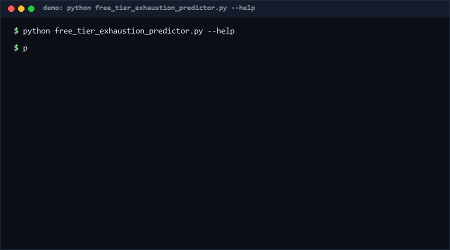

# free-tier-exhaustion-predictor

Free tiers die quietly: usage drifts up while the quota barely moves, and the service stops mid-month. This tool reads a dated usage log and a quota, runs three rate estimators (overall, trailing-7, slope-simulated), and reports an exhaustion date range plus downgrade suggestions. Vendor neutral: generic "units" and "quota", never a provider API. Pure Python, standard library only.

As of 2026-10-13, no direct equivalent found as of 2026-10-13: cloud consoles show current spend, but searches across GitHub (194 queries) and the web found no standalone, vendor-neutral rate-extrapolation exhaustion forecaster.

<p align="center"></p>

## Problem

Quota exhaustion is predictable in hindsight and surprising in the moment. Dashboards show cumulative usage; nobody diffs the *rate* week over week. When a team's call volume grows 15% monthly, "we still have 40% left" silently means "two weeks left". Finance finds out from a hard error, not a forecast.

## How it works

1. **Log ingestion.** JSONL entries `{"date": "2026-10-01", "units": 120}` — unsorted input is sorted, same-day entries aggregate, fractional units allowed.
2. **Three estimators.** *Overall* mean over the inclusive observed span; *trailing-7* mean of the last week (robust to old low-usage days); *simulated* day-by-day projection adding the least-squares slope to the trailing base (captures acceleration), capped at a 10-year horizon.
3. **Exhaustion window.** Each estimator yields a date (or "never"); the window is [earliest, latest] across estimators — a widening gap between them is itself the acceleration signal.
4. **Suggestions.** With `--reset monthly`, a daily cap is computed to stretch the remaining quota to the next reset (`cap daily usage at N units to last until reset …`); accelerating trends and pre-reset exhaustion each add their own advice.

## Quickstart

Requires Python 3.8+. No dependencies, no API keys, no network. A 30-day forecast runs in < 1 ms [Measured].

```bash
python free_tier_exhaustion_predictor.py predict --log usage.jsonl --quota 100000 --reset monthly
python free_tier_exhaustion_predictor.py predict --log usage.jsonl --quota 100000 --json
```

Example output (text mode): `rates: overall=100.00/day trailing7=100.00/day`, then `exhaustion[overall]: 2026-11-07`, a window line, and suggestions.

## Why not X

- **Cloud/vendor consoles and billing alerts**: show spend *of that vendor* and need per-provider setup; this is one algorithm over any log, with zero credentials. No direct equivalent found as of 2026-10-13 for a neutral standalone forecaster.
- **Full budgeting apps**: track money across categories; overkill for one quota and blind to per-day unit rates.
- **Spreadsheet trendlines**: can reproduce the linear fit but not the day-by-day simulation, the reset-date caps, or the exit-code workflow.
- **Observability platforms with forecasting**: powerful but billed per signal and configured per metric; this is a zero-dependency CLI for the single question "when do we run out".

## Performance

Measured on Windows 10, Python 3.13, single core:

| Workload | Time | Reproduce |
|---|---|---|
| 30-day log forecast [Measured] | < 0.001 s | `python free_tier_exhaustion_predictor.py predict --log usage.jsonl --quota 100000 --reset monthly` |
| 1,000-day history forecast [Measured] | < 0.05 s | generate a year-scale log and run the command above |

All computation is a handful of linear passes over the log — O(n) in entries.

## Minimal Fallback

No Python? Note today's remaining quota, wait seven days, note it again: `daily_rate = (used difference) / 7`, then `days_left = remaining / daily_rate`. That is the trailing-7 estimator by hand; it misses acceleration (the slope term) and reset-aware caps.

## Design Trade-offs

- **Extrapolation only — no provider integration.** By red line: the algorithm consumes any log; binding a vendor API would couple the tool to one pricing schema and its credentials.
- **Three estimators instead of one "best".** Each is honest about a different assumption (stationary, recent, accelerating); the range communicates uncertainty instead of hiding it.
- **`int(days)` truncation** in date projection makes the estimate conservative (never claims a later date than the math supports).
- **Suggestions are advisory text.** They compute real numbers (daily caps, reset dates) but never modify anything.

## Limits & Second-order Effects

- Linear extrapolation is blind to steps: a planned feature launch invalidates the forecast the day it ships.
- A "cap daily usage" suggestion, if enforced bluntly, teaches the team to move usage to another (unmeasured) tier.
- Quotas that reset on rolling windows (not calendar months) are only approximated by `--reset monthly`.
- The tool may create false confidence during low-variance weeks; an accelerating trend flagged today can still reverse tomorrow.

## FAQ

**When NOT to use this?** Not for billing-grade cost forecasting (rates here are unit-based, not price-weighted), not for bursty on-demand traffic where rates are meaningless, and not as an enforcement mechanism — it predicts, it does not throttle.

**Does it call any vendor API?** Never. Input is a local JSONL file; the tool has no network code at all.

**Why three dates instead of one?** One date implies one assumption; the [earliest, latest] window shows how much the conclusion depends on recent behaviour.

**What if usage already exceeded the quota?** `exhausted: true`, `remaining ≤ 0`, exit code 1 — you get the facts, not a fake future date.

## [Core Assumptions]

- **Recent usage is the best predictor of near-term usage.** Confidence: medium-high — the reason trailing-7 exists alongside the overall mean.
- **Quotas are fixed totals (or calendar-month resets).** Confidence: high for the target tiers; rolling windows are approximations.
- **Units are commensurable across the log** (same metering definition throughout). Confidence: medium — redefinitions mid-history will distort slopes.
- **Extrapolation horizon ≤ 10 years is meaningful.** Confidence: high as a sanity cap; beyond that the answer is "effectively never".

As of 2026-10-13.

---

Part of the [zhengming-toolbox](https://github.com/chenhz01/zhengming-toolbox) — 105 purpose-built AI-engineering tools across neglected niches.

Related tools: [token-price-table-validator](https://github.com/chenhz01/token-price-table-validator) · [oncall-handoff-spec](https://github.com/chenhz01/oncall-handoff-spec) · [merge-conflict-predictor](https://github.com/chenhz01/merge-conflict-predictor)
